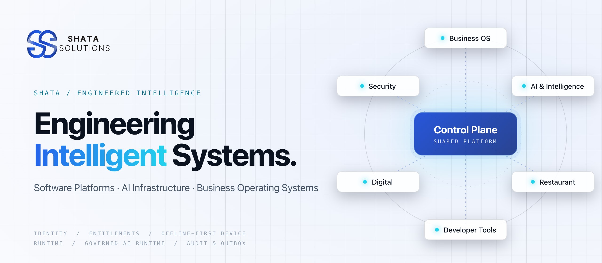
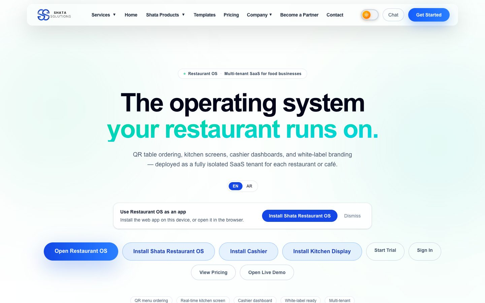
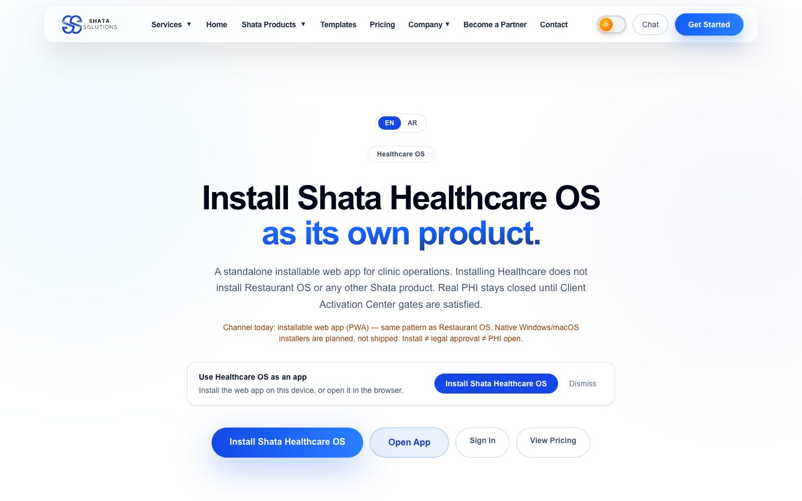
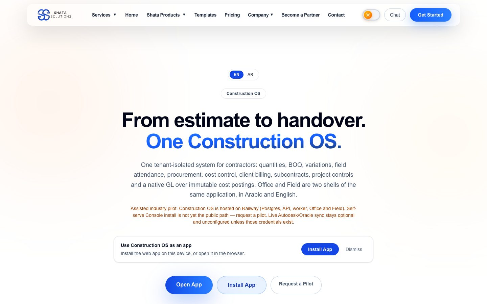
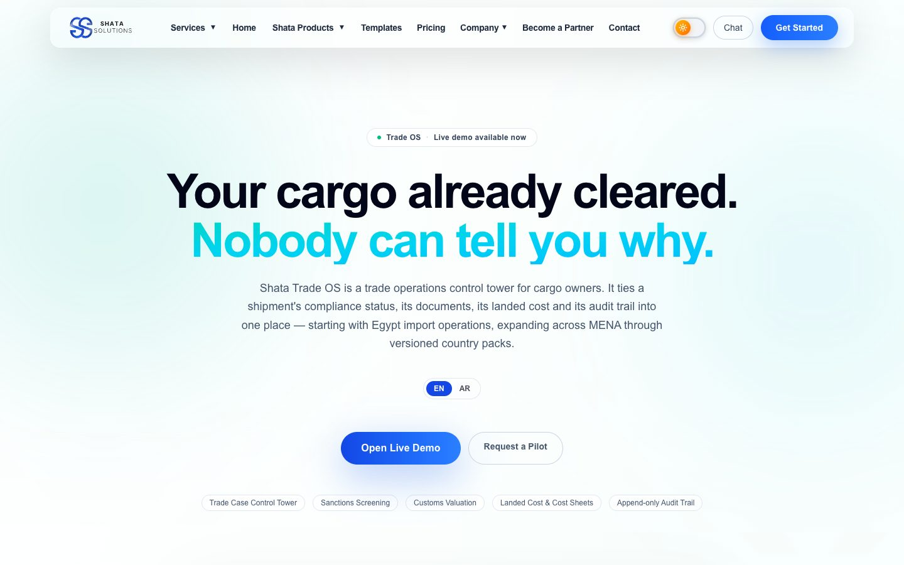
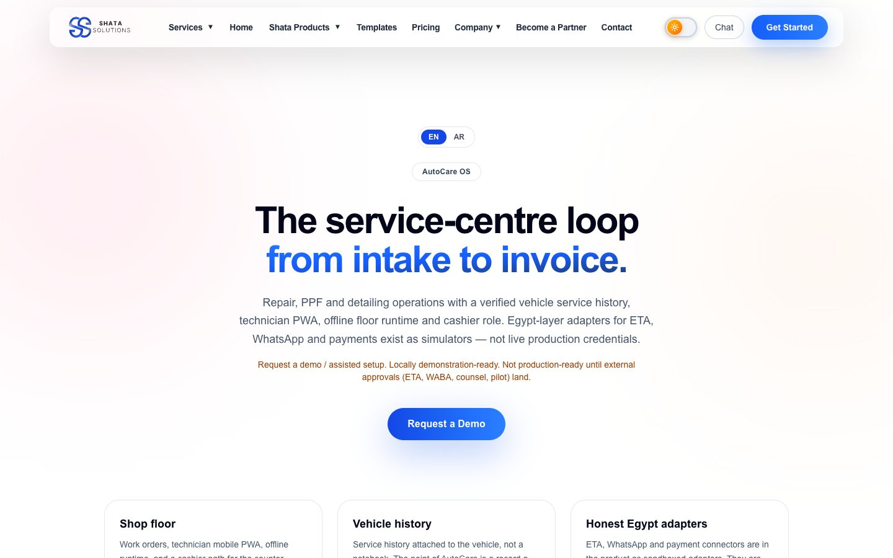
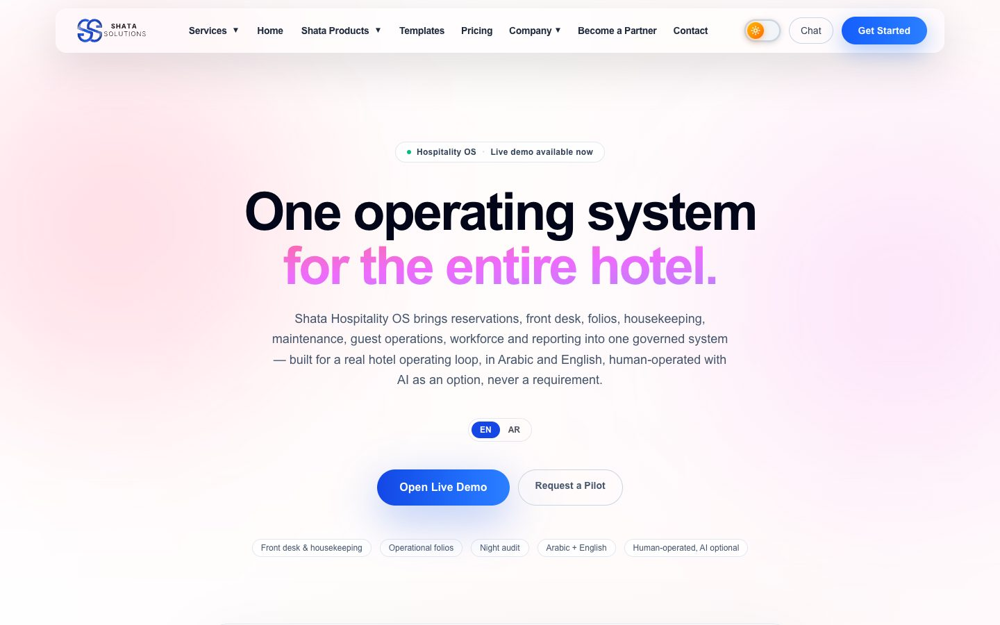
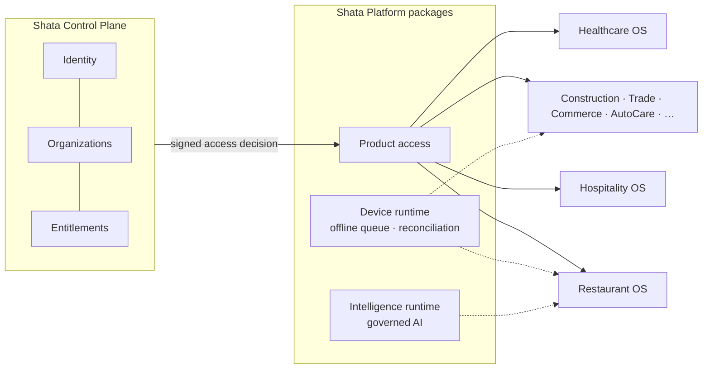

<a href="https://www.shatasolutions.com">
  <picture>
    <source media="(prefers-color-scheme: dark)" srcset="assets/hero-dark-2560x1120.jpg">
    
  </picture>
</a>

  <a href="https://www.shatasolutions.com"><b>Website</b></a> &nbsp;·&nbsp;
  <a href="#product-families"><b>Products</b></a> &nbsp;·&nbsp;
  <a href="#how-it-fits-together"><b>Architecture</b></a> &nbsp;·&nbsp;
  <a href="#how-we-engineer"><b>Engineering</b></a> &nbsp;·&nbsp;
  <a href="#open-source"><b>Open source</b></a> &nbsp;·&nbsp;
  <a href="#work-with-us"><b>Contact</b></a>

---

**Shata Solutions is a software engineering company.** We design and build complete
operating systems for real businesses — restaurants, hotels, clinics, contractors,
retailers, traders and service centres — together with the AI and platform
infrastructure they run on.

Every product is built on one shared foundation: a single control plane for identity,
organizations and entitlements, versioned platform packages, an offline-first device
runtime and a governed AI runtime. That is why a new Shata product starts from proven
infrastructure instead of from zero.

## Product families

Statuses below are the public status of each product, as stated on
[shatasolutions.com](https://www.shatasolutions.com). Product source code is private;
pages link to the public product site.

### Business Operating Systems

| Product | Built for | What it runs | Status |
| --- | --- | --- | --- |
| [**Restaurant OS**](https://www.shatasolutions.com/restaurant-os) | Restaurants and cafés | QR table ordering, kitchen screens, cashier stations and white-label branding — each restaurant an isolated tenant | Live |
| [**Hospitality OS**](https://www.shatasolutions.com/hospitality-os) | Hotels and resorts | Reservations, front desk, folios, housekeeping and reporting, in Arabic and English | Live demo |
| [**Healthcare OS**](https://www.shatasolutions.com/healthcare-os) | Clinics | Installable clinical and operational web app; real patient data stays closed until activation gates are met | Live app · PHI closed |
| [**Construction OS**](https://www.shatasolutions.com/construction-os) | Contractors | Quantities, BOQ, variations, procurement, cost control and client billing for office and field | Assisted pilot |
| [**Trade OS**](https://www.shatasolutions.com/trade-os) | Importers and exporters | One trade case per shipment: compliance, documents, landed cost and an append-only audit trail | Live demo |
| [**Commerce OS**](https://www.shatasolutions.com/commerce-os) | Retail and supermarkets | Offline-first register, till reconciliation, promotions and loyalty, and reports from an append-only ledger; Supermarket OS is the first vertical | Early access · live demo |
| [**AutoCare OS**](https://www.shatasolutions.com/autocare-os) | Auto service centres | Intake to invoice for repair, PPF and detailing, with a verified service history per vehicle | Demo on request |
| [**Automotive OS**](https://www.shatasolutions.com/automotive-os) | Used-car dealers | True cost per vehicle, owner-only margin, inventory aging, leads and the sales pipeline, Arabic first | Demo ready |
| [**Energy OS**](https://www.shatasolutions.com/energy-os) | Oil & gas operators | Industrial safety memory: incidents, findings, corrective actions and evidence in one governed workspace with human-decided closure | Live demo |

### AI & Intelligence

| Product | What it is | Status |
| --- | --- | --- |
| [**Markets OS**](https://www.shatasolutions.com/markets-os) | Capital-markets intelligence terminal for Egypt (EGX) and the US, on clearly labelled demonstration data. Not advice, not a brokerage | Evaluation |
| **Codingo** | An independent agent operating system: models propose, a deterministic core decides, gates, executes and rolls back | In development |
| **Shata One** | A secure mobile chief of staff that prepares the day and waits for your approval before it acts | In development |

### Restaurant ecosystem

| Product | What it is | Status |
| --- | --- | --- |
| [**Self Ordering**](https://www.shatasolutions.com/self-ordering) | Customer, kiosk and admin apps for digital self ordering, bilingual, standalone or inside Restaurant OS | Live demo |
| [**Shata Cashier**](https://www.shatasolutions.com/install/shata-cashier) | Native desktop cashier station for Restaurant OS, activated with a device code from Shata Console | Awaiting code signing |

### Platform & infrastructure

| Component | What it does |
| --- | --- |
| **Shata Control Plane** | Identity, organizations, memberships, entitlements and provisioning. Issues signed access decisions that every product enforces |
| **Shata Platform** | Versioned shared packages: contracts, configuration, identity, product access, onboarding, activation, device runtime and intelligence runtime |

<b>Also on shatasolutions.com</b> — automation, actors and digital services

 

The [Automation Platform](https://www.shatasolutions.com/services/automation), the
[Actor Library](https://www.shatasolutions.com/actors),
[website templates](https://www.shatasolutions.com/templates) and the company's digital
services (websites, branding, business setup) run on the same codebase as the public
website.

## Featured on the web

<table>
  <tr>
    <td width="33%" valign="top"> <b>Restaurant OS</b> The operating system your restaurant runs on.</td>
    <td width="33%" valign="top"> <b>Healthcare OS</b> Installable clinical platform, PHI-gated.</td>
    <td width="33%" valign="top"> <b>Construction OS</b> From estimate to handover.</td>
  </tr>
  <tr>
    <td width="33%" valign="top"> <b>Trade OS</b> Trade operations control tower for cargo owners.</td>
    <td width="33%" valign="top"> <b>AutoCare OS</b> The service-centre loop, intake to invoice.</td>
    <td width="33%" valign="top"> <b>Hospitality OS</b> One operating system for the entire hotel.</td>
  </tr>
</table>

Captures of the public product pages, 2026-10-29.

## How it fits together

Each product owns its own business data and database. The control plane holds only
identity and entitlement facts and never a business record; products verify its signed
decision themselves and keep working through short outages instead of failing open.

## How we engineer

- **AI is optional, never load-bearing.** Every AI feature has a complete manual
  counterpart. Deterministic code owns money, stock, permissions and compliance state;
  models read snapshots and propose.
- **Offline-first where the business needs it.** Point-of-sale, kitchen and field
  operations keep working without a connection and reconcile idempotently.
- **Tenant isolation in the database.** Row-level security and composite keys make
  cross-tenant access a database error, not a code review finding.
- **Every change leaves evidence.** Append-only audit logs, transactional outboxes,
  release evidence gates and rehearsed backup and restore.
- **Status claims match the code.** Prototypes are labelled prototypes, demo data is
  labelled demo data, and simulated integrations say so on their own output.

All repositories follow one engineering handbook and repository blueprint, checked
mechanically in CI by our open-source tooling.

<b>Technology we work in</b>

 

| Area | In production code today |
| --- | --- |
| Languages | TypeScript (strict), SQL |
| Web & apps | Next.js, React, React Native / Expo, Electron, PWAs |
| Services | NestJS, Node.js, Prisma, PostgreSQL with row-level security, Redis |
| Identity | Supabase Auth (ES256 / JWKS), signed entitlement grants |
| AI | Provider-isolated model gateways, prompt registry, provenance and usage records |
| Delivery | Turborepo, GitHub Actions, Docker, Railway, Vercel, infrastructure as code |
| Quality | Vitest, Playwright, Maestro, contract tests, backup/restore drills |

## Open source

| Project | What it does |
| --- | --- |
| [`engineering-os-tools`](https://github.com/shata-solutions/engineering-os-tools) | Zero-dependency repository blueprint checker and engineering-score tool, with reusable GitHub Actions workflows. MIT. |

## Work with us

- **Website:** [shatasolutions.com](https://www.shatasolutions.com)
- **Pilots, partnerships and sales:** [sales@shatasolutions.com](mailto:sales@shatasolutions.com)
- **General enquiries:** [info@shatasolutions.com](mailto:info@shatasolutions.com)
- **Security reports:** see [SECURITY.md](https://github.com/shata-solutions/.github/blob/main/SECURITY.md)

Nothing on this page claims a capability, customer or production status that the product's own documentation does not support.
